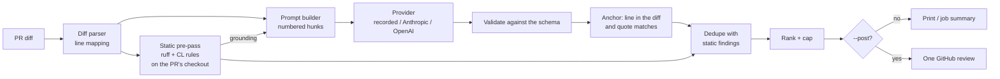

# CodeLens

An LLM pull-request reviewer and test generator that runs as a GitHub Action. It leaves a few precise comments
on the lines a PR changed, grounded by static analysis, and proposes pytest tests for changed Python functions,
keeping only the ones that pass and add coverage.

**Status: day 4 of 5.** Built so far: the unified-diff parser every comment is anchored through (day 1); the
review engine (day 2): a provider interface with a recorded provider by default and opt-in Anthropic and
OpenAI providers, a findings schema with strict validation and quote-checked anchoring, one-review posting
to GitHub with a dry run, and the action's review step; (day 3) a static pre-pass (ruff plus four rules of
CodeLens's own) whose findings are posted and shown to the model, one dedupe rule across both sources, and
an eval set of 14 pull requests with seeded bugs scored by `codelens eval`; and (day 4) test generation:
`codelens testgen` asks for pytest tests of the changed top-level functions, runs each in a child process
with an allow-listed environment and a timeout, and keeps the ones that pass and run lines of a changed
function nothing else ran. CodeLens reviewing its own PRs and the v1.0.0 release (day 5) are next. See
[DESIGN.md](DESIGN.md) for the whole plan.

## How it works



1. The diff is parsed into files, hunks and lines, each with its old and new line numbers.
2. The static pre-pass runs ruff (isolated from the PR's own config) and CodeLens's four rules on the Python
   files the PR changes, read from a checkout whose lines must match the diff. It keeps the problems the PR
   introduces: hits on added lines, and hits on unchanged lines that the old version (rebuilt from the file
   and the diff) didn't have.
3. The prompt shows each reviewable file's hunks with new-file line numbers in the margin, then the static
   findings as checked facts, and tells the model the diff is untrusted input.
4. The model answers a JSON object of findings (structured output). Each finding names a path, a line, the
   exact text of that line (`quote`), a severity, a category, a title, a body and a confidence.
5. Every finding is validated and anchored: the line must be in the diff and must say what the quote says.
   Anything that fails is dropped with a reason, never moved. Static and model findings are merged, one per
   line (the most severe), ranked worst first and capped at 10.
6. The review is printed (dry run), written to the Actions job summary, or posted as one GitHub review with a
   line comment per finding.

## Use it

### CLI

```bash
git diff main... > pr.diff
codelens diff pr.diff                 # what is reviewable
codelens static pr.diff               # the static pre-pass only (reads the files from . or --source-root)
codelens prompt pr.diff               # exactly what the model would be sent, static block included
codelens review pr.diff               # review it (recorded provider, dry run)
codelens eval                         # score it on the eval set (precision and recall)
codelens testgen pr.diff --tests tests  # propose tests for the changed functions; keep the useful ones
```

`review` and `prompt` run the static pre-pass on `--source-root` (default `.`), which must be a checkout of
the diff's new version: a file whose lines don't match the diff is skipped and named in the output.
`--no-static` turns the pre-pass off, and `--min-severity medium` (or `high`, `critical`) leaves out the
less severe findings after the merge; the model isn't told the threshold, so one recording serves every
setting. Without the `static` extra (`pip install 'codelens[static]'`, which
pins ruff 0.16.10) only CodeLens's own rules run, and the output says so.

Output on the sample PR in this repo, replayed from its recording
(`codelens review tests/fixtures/sample_pr.diff --recordings tests/fixtures/recordings`):

```text
shop/orders.py:15  high  bug  An unknown discount code raises KeyError  (confidence 0.90)
shop/orders.py:22  medium  bug  Every page returns one order too many  (confidence 0.85)
tests/test_orders.py:7  low  test  No test for an unknown code or for pagination  (confidence 0.70)
3 findings on 2 reviewed files (recorded: hand-written, 0 input / 0 output tokens)
dropped 1: misquoted 1
  [2] misquoted: shop/orders.py:16 is 'return round(total, 2)', not 'total -= total * DISCOUNTS[code]'
dry run: nothing posted (pass --post to post the review)
```

That recording is **hand-written** test data (its third answer is a deliberate off-by-one citation, to show
the quote check dropping it); it is not model output. `--json` prints the same as JSON plus the exact Reviews
API payload; `--summary-file FILE` appends the review as Markdown.

`testgen` reads the changed functions from `--source-root` like the pre-pass, runs the existing suite
(`--tests`, repeatable, paths in the checkout) for a baseline, then each candidate on its own in a scratch
directory with a 60 s `--timeout`. It needs pytest and coverage in the interpreter that runs the tests
(`pip install 'codelens[testgen]'`, or `--python` for the project's own virtualenv). `--out DIR` writes the
kept tests; `--json` adds every candidate's code and output. Output on the sample in this repo, replayed
from its hand-written answer (the command is under "Test generation (day 4)" below):

```text
dropped [0] stock.levels.reorder_point: passes, but runs no new line of a changed function
kept    [1] stock.levels.reorder_point: passes, and runs 1 new line of changed functions
...
dropped [7] stock.levels.units_to_order: fails
dropped [8] stock.levels.units_to_order: timed out
dropped [9] stock.levels.units_to_order: ended without reporting a result
rejected [10] unknown-function: 'stock.levels.reorder' is not a changed function shown
rejected [11] not-python: the code does not parse
3 changed functions in 1 file: kept 5 of 10 tests run
tests from recorded: hand-written, 0 input / 0 output tokens
  stock.levels.reorder_point: statements run 3 of 5 before, 5 of 5 after
  stock.levels.parse_sku: statements run 5 of 7 before, 7 of 7 after
  stock.levels.units_to_order: statements run 0 of 6 before, 5 of 6 after
coverage of the changed functions: 8 of 18 statements before, 17 of 18 after (+50.0 points)
  of them on lines the diff adds: 7 of 17 before, 16 of 17 after
existing suite: passed (2 passed)
```

Generated tests run the PR's code, so run `testgen` where the PR's own tests already run, in a step with
no secrets in it (DESIGN.md, "Security"). The action doesn't run it yet.

### Live providers (opt-in)

Tests and CI never call a model or need a key. To review with a real model:

```bash
export ANTHROPIC_API_KEY=...          # or OPENAI_API_KEY with --provider openai
codelens review pr.diff --provider anthropic
codelens review pr.diff --provider anthropic --record --recordings .codelens/recordings   # save for replay
```

| Variable | Default | Meaning |
|---|---|---|
| `CODELENS_PROVIDER` | `recorded` | `recorded`, `anthropic` or `openai` (`--provider` wins) |
| `CODELENS_MODEL` | `claude-opus-5-5` / `gpt-5` | model for the live provider (`--model` wins) |
| `CODELENS_EFFORT` | `high` | Anthropic `output_config.effort`: `low` to `max` |
| `CODELENS_MAX_TOKENS` | `16000` | output limit; thinking tokens count against it |
| `CODELENS_FALLBACKS` | `1` | `0` turns off Anthropic's server-side refusal fallbacks |
| `CODELENS_BASE_URL` | vendor API | endpoint override (`ANTHROPIC_BASE_URL` is deliberately not read) |
| `CODELENS_RECORDINGS` | `.codelens/recordings` | where the recorded provider looks (`--recordings` wins) |

The Anthropic request asks for structured output matching the findings schema and opts into server-side
refusal fallbacks (`"fallbacks": "default"`), so a request a safety classifier declines is retried on another
model; the review reports which model answered. A refusal or a cut-off answer fails the run instead of
posting half a review.

### Posting

```bash
GITHUB_TOKEN=... codelens review pr.diff --provider anthropic --post --repo owner/name --pr 42 --commit "$SHA"
```

One review per run (`event: COMMENT`), so the author gets one notification. Posting is never retried (the
Reviews API has no idempotency key). If GitHub rejects the line comments with a 422, the review is posted once
more with the findings in its body. Findings an earlier CodeLens review already posted on the PR (matched by
an invisible fingerprint of file, line text and position among identical lines, read only from CodeLens's
own comments) are not posted again, so pushing more commits doesn't repeat old comments; a review with
nothing new is not posted. Set `CODELENS_GITHUB_LOGIN` if CodeLens posts as something other than
`github-actions[bot]`.

### GitHub Action

```yaml
# .github/workflows/codelens.yml
on: pull_request            # not pull_request_target: see DESIGN.md, "Posting to GitHub"
jobs:
  review:
    runs-on: ubuntu-latest
    permissions:
      contents: read
      pull-requests: write  # to post the review
    steps:
      - uses: actions/checkout@v7
      - uses: vivekdavara/codelens@main
        with:
          provider: anthropic
          api-key: ${{ secrets.ANTHROPIC_API_KEY }}
```

Inputs: `provider` (default `recorded`), `api-key`, `model`, `recordings`, `post` (default `"true"`),
`max-findings` (default 10), `max-prompt-chars` (default 200000), `min-severity` (default `low`, keep
everything; `medium` leaves out the minor ones), `static` (default `"true"`),
`source-root` (default the workspace), `diff-file`, `github-token`, `python-version`. Outputs: `files`,
`findings`, `rejected`, `static` (how many of the findings came from the pre-pass), `diff-file`. On
`pull_request`, `actions/checkout` checks out the merge commit by default; files the base branch also
changed then differ from the PR's diff and are skipped by the pre-pass, so for every file to be checked use
`ref: ${{ github.event.pull_request.head.sha }}`. The review
always goes to the job summary. On a fork's PR there are no secrets, so the review is skipped with a notice
rather than failing the job; the same happens for the recorded provider without `recordings`. Only a review
of the PR's own diff is ever posted (never of a `diff-file`), pinned to the event's head commit; if a newer
push has landed by the time the diff is fetched, the review is skipped and that push's run reviews it.

## Results so far

### Test generation (day 4)

On the `stock` sample (`evals/testgen/`: a warehouse module whose PR adds input checks, a safety buffer and
a new function; the existing suite has two happy-path tests), from a **hand-written** answer: there is no
API key on this machine, so the 12 candidates were written by hand to exercise every decision the filter
makes (two tests of new behaviour on old lines, a wrong expectation, a 120 s sleep, an `os._exit(0)`, an
unknown function, code that doesn't parse). These numbers measure the filter and the accounting, not a
model.

| What | Result | Reproduce |
|---|---|---|
| Candidates kept | 5 of the 10 that ran; 2 more rejected before running | `.venv/bin/codelens testgen evals/testgen/cases/stock/pr.diff --source-root evals/testgen/cases/stock/after --tests tests --recordings evals/testgen/recordings --timeout 5` |
| Coverage of the changed functions' bodies | 8 of 18 statements (the existing suite) → 17 of 18 (+50.0 points) | same |
| Of those, on lines the diff adds | 7 of 17 → 16 of 17 | same |
| Time | 7.4 s wall time (median of 3) on an Apple M3, 5 s of it the candidate that sleeps until its timeout | same, under `time` |
| A test that leaves a 30 s background process | 0.29 s, the process killed with the run; 30.2 s for the first version, which read the output through a pipe (when the test turns pytest's capture off; with capture on, 0.2 s either way) | `.venv/bin/python scripts/measure_runner_stall.py` |

Two of the dropped candidates check behaviour the PR added, but on lines the existing suite already ran, so
line coverage can't tell them from a repeat. Kept tests also pin current behaviour: a test of what buggy
code should do fails and is dropped. Both are in DESIGN.md's "What it measures, and what it can't", with what
would do better (branch coverage, mutation testing). `tests/test_testgen_sample.py` pins the numbers.

### Review of the day's work (day 4)

Two review agents read the day's code, one the runner (`sandbox.py`) and one the generator and CLI, and
reported only what they had reproduced. I reproduced the main claims again before fixing them, and every fix
has a test that fails on the old code. 17 problems were fixed, the worst first:

- **False passes.** pytest's exit status 0 also means "failed as expected" (xfail), "skipped after running
  code" and `pytest.exit(returncode=0)`, and the generator kept such tests. A run now passes only if a test
  passed and none skipped, xfailed, xpassed, failed or errored (counted by a plugin in the child).
- **Candidates could change each other's verdicts.** They shared a directory, so a `conftest.py` written
  by one turned the next one's failure into a pass. Each run now gets its own copy and `--noconftest`.
- **A passing run reported as a timeout**, when a test left a thread running: the child now exits as soon
  as its report is written.
- **Crashes after the paid call**: a relative or missing `--python`, and a symlink loop in the checkout,
  which crashed the day-3 static pre-pass too (`codelens review`).
- **Wrong coverage accounting**: one-line functions counted as covered by the import, and an edit inside
  a multi-line statement counted as no changed statement.
- And: an interrupt left the child running, UTF-8 mode never took effect under `-I`, bytecode landed in
  the checkout, a checkout path with `[` measured nothing, `src/` as a package got the wrong module name,
  `tests.py`, `conftest.py` and `test*` functions were targets, a byte-order mark made a file "not parse",
  and `--out` overwrote files.

### The eval set (day 3)

14 small pull requests, 12 of them with 23 seeded bugs and 2 clean, described in
[evals/README.md](evals/README.md). `codelens eval` reviews each one and scores what each source would post:

| Source | Cases scored | Findings | Correct | Precision | Bugs found | Recall |
|---|---|---|---|---|---|---|
| static pre-pass | 14 of 14 | 14 | 14 | 100.0% | 14 of 23 | 60.9% |
| model alone | 0 of 14 | not recorded | | | | |
| static + model (posted) | 0 of 14 | not recorded | | | | |

(`codelens eval`; a test pins the static row, so a rule change that loses a bug or adds a false positive
fails CI.) What these numbers are worth:

- **The static row is an upper bound.** The rules and the cases were written by the same author on the same
  day, and about half the bugs are of a kind a rule targets. The 9 it misses are the semantic ones a rule
  can't see: a `KeyError` on an unknown discount code, off-by-one pagination (two), a list mutated through
  `self.handlers[topic]` while iterating it, a swallowed timeout, a `None` cache entry dereferenced, tax
  rounded to whole dollars, path traversal, and a timing-unsafe token comparison.
- **The model rows are empty on purpose.** They need real model answers, and there was no API key on the
  machine that built this, so no number is claimed; hand-written answers would measure nothing. Recording
  them is one command (below, "Not measured yet").
- **The eval changed the design.** Its first run found that a PR making a method `async` turns its
  unchanged `time.sleep()` and `self.flush()` lines into bugs the pre-pass couldn't see, because it only
  read added lines. It now also reports new hits on unchanged lines (DESIGN.md, "Which files, and which
  lines").

### The static rules on mature code (day 3)

How often each rule fires on 296 files of the Python 3.11.12 standard library (128,452 lines), each
reviewed as if a PR had added it whole (`.venv/bin/python scripts/measure_static_noise.py`):

| Where | Hits | Per 1,000 lines |
|---|---|---|
| all files | 1,330 | 10.35 |
| test files (80,323 lines) | 1,179 | 14.68 |
| other files (48,129 lines) | 151 | 3.14 |

The pre-pass on those 296 files took 3.34 s (median of 3 runs, Apple M3; the script prints it): ruff is
0.04 s of that, and CodeLens's own AST rules most of the rest. Sharing each function's bound names between
two rules took the rules from 2.92 s to 2.30 s with identical hits on every file.

F841 (unused local) is 1,012 of the hits, 873 of them in one file, `test_exceptions.py`, which assigns
without reading on purpose; F821 is 127, 93 of them in `turtle.py`, which defines names with `exec`; 37 of
the 61 rules never fired (numbers after the day's fixes; the first run had 1,331 hits). Most hits on shipped code are deliberate (the standard library calls `eval` and
`pickle` on purpose), so these are a ceiling on noise, not a false-positive rate. The first run found:

- **two real bugs in the standard library**: CL004 flagged `test/support/__init__.py` lines 923 and 2077,
  error messages written without the `f` prefix that print `{limit!r}` and `{max_depth}` literally;
- **two false-positive classes in CodeLens's own rules**, fixed with tests: CL003 on
  `for cookie in self: self.clear(domain, path, name)` in `http/cookiejar.py` (that's CookieJar's own
  `clear`, and the jar iterates a snapshot; CL003 now checks arities against the built-in methods), and
  CL004 on `.replace("{max_findings}", ...)` in CodeLens's own `prompts.py` (search tokens are now skipped).
  A test requires 0 hits on CodeLens's own sources.

### The static pre-pass on real pull requests (day 3)

Every non-merge commit of this repository, reviewed as a PR (`git diff C^ C`) against its own tree
(`.venv/bin/python scripts/measure_static_history.py`, at `d9bfbe5`): 93 commits, 77 touching Python, 245
Python file diffs, 10,895 added Python lines, **15 findings**. Fourteen are the eval set's seeded bugs, in
the commit that added the cases (`eb6a818`). The fifteenth is a false positive: S105 ("possible hardcoded
password") on `TOKEN = "ghs_test_not_a_real_token"` in `tests/test_github.py`. S105 stays, at medium
severity and confidence 0.5, because a real secret pasted into a test is still a leak. (A run in between,
after the review fixes, also flagged a CL004 false positive in a test written that day: a string of code
assigned to a variable its braces named. CL004 now skips that pattern.)

### Review of the day's work (day 3)

Three review agents read the day-3 diff (static pre-pass and rules; eval harness, CLI and action;
review, prompt and posting), each confirming its claims by running code; I checked each claim before
fixing it. 26 problems were fixed, each with a regression test. The worst:

- **A PR could run code in the action.** The pre-pass ran `python -m ruff` in the PR's checkout, where
  `-m` imports a planted `ruff.py` first; and since day 1 the action's `python -m pip` and
  `python -c 'import json…'` ran there too. Ruff now runs as a binary, and every `python` in the action
  runs with `-I`.
- **A PR could crash the review** with an expression nested a few thousand deep (RecursionError in the
  parser), **or silence it**: with `# noqa` comments (ruff now runs `--ignore-noqa`), or with a file name
  containing a fingerprint marker (markers now count only on a line of their own).
- **Wrong lines and wrong counts**: a lone `\r` shifted every later static finding by a line (such files
  are now skipped), CRLF files were never checked, an "old" hit was matched by text anywhere in the file
  instead of at its line, and two findings on one line shared one fingerprint (dedupe is now one per
  line).

One known gap stays, narrowed: CL003 can't tell whether `d.update(...)` adds a key, so it flags every
update except one whose only keys are the loop's own (`for k in d: d.update({k: ...})`), which can't.

### Earlier days

| What | Result | Reproduce |
|---|---|---|
| Tests | 648 passing | `.venv/bin/pytest` |
| Pre-pass property tests (day 3) | 120 seeded edits diffed by real git at `-U0`, `-U1` and `-U3`: `old_version` rebuilds every old file exactly (it found one end-of-file case, fixed); 2,000 seeded mutations of real code never crash the CodeLens rules; on random edits every static finding sits on a shown line and quotes it | `.venv/bin/pytest tests/test_old_version.py tests/test_static_fuzz.py` |
| Line + branch coverage | 99% overall: every module 100% except the day-1 parser, `diff.py`, at 98% | `.venv/bin/pytest --cov` |
| Quote check on near-miss citations | rejects 16,738 of 17,366 (96.4%) off-by-one/two citations that land inside a hunk, where line anchoring alone would accept them; 0 correct citations rejected | `.venv/bin/python scripts/measure_quote_check.py` |
| Real history | every commit of this repository parses and renders: 48 commits, 122 file diffs, 0 failures at `8646d07` (another local clone, 50 Java/SQL/YAML commits: 0 failures) | `.venv/bin/python scripts/check_history.py [repo]` |
| Differential check against real git (day 1) | 150 seeded random edits: full-context hunks rebuild both files exactly; every line at default context matches its file line | `.venv/bin/pytest tests/test_diff_against_git.py` |
| Fuzzing the untrusted parsers | 1,500 seeded rounds each of random and mutated JSON for findings, both vendors' responses, error bodies and recordings: only documented errors raised; found one bug (negative token counts), fixed | `.venv/bin/pytest tests/test_fuzz.py` |
| The action, end to end | CI job `action-review` runs a full review of the sample PR through `action.yml` from its recording and checks 3 findings kept, 1 rejected; `action-static` reviews an eval case with the pre-pass and checks 2 findings, 1 static | `.github/workflows/ci.yml` |

The quote-check measurement uses synthetic edits (seeded insertions, deletions and changed lines) on real
code: 300 sampled files of the Python 3.11.12 standard library, diffed by git, 5,423 commentable lines. The
3.6% it lets through land on a line whose text equals the intended one (438 blank lines, 118 identical lines,
72 where the quote is part of the neighbour). Off-by-one alone: 9,046 of 9,396 (96.3%)
(`scripts/measure_quote_check.py --offsets=-1,1`). A test keeps the rate on this repo's own sources above 90%
(95.8%, 596 of 622, at `a220a7f`), so loosening the rule fails CI.

### Not measured yet

The model's review quality. With a key, one command records a real answer for every eval case (14 calls) and
prints all three rows:

```bash
ANTHROPIC_API_KEY=... .venv/bin/codelens eval --provider anthropic --record
```

The answers land in `evals/recordings/`, after which plain `codelens eval` (and CI) replays them.

The model's test writing, the same way: one call records a real answer for the test-generation sample
(the command is in `evals/testgen/README.md`), and the report then measures a model instead of the filter.

## Develop

```bash
python3.11 -m venv .venv
.venv/bin/pip install -e '.[dev]'
.venv/bin/pytest
.venv/bin/ruff check . && .venv/bin/ruff format --check . && .venv/bin/mypy
```

The provider and GitHub tests run against a scripted local HTTP server (`tests/conftest.py`), so retries,
timeouts, refused redirects and error bodies are exercised over real sockets without any network access. After
changing the prompt or the schema, regenerate the sample recording with `scripts/hand_record.py` (the test
that fails tells you the command).

## Design decisions

- **Drop, don't snap; and quote, don't trust line numbers.** A finding must cite a line in the diff *and*
  quote it. A comment on a neighbouring line reads as a confident claim about the wrong code.
- **Recorded by default, loud on a miss.** CI is deterministic and keyless; a prompt change can't silently
  replay a stale answer.
- **The diff is untrusted.** The prompt says so, its structure can't be faked from inside the diff, and model
  output is data: validated, anchored, `@mentions` broken before posting.
- **Standard library only.** The vendors are called over raw HTTP with one retrying client: fast action
  installs, a small attack surface, and every header and retry decision is visible and tested.
- **One review, never retried.** One notification per run, and no duplicate reviews after a timeout.
- **Static findings are facts the model starts from, not a second opinion.** They are checked, posted, and
  listed in the prompt; the model's own finding on the same line replaces one only when it ranks higher.
- **The PR doesn't configure, or run code in, its reviewer.** Ruff runs `--isolated --ignore-noqa` with
  CodeLens's own rule list, so neither `pyproject.toml` nor `# noqa` can switch a rule off, and it runs as
  a binary so nothing in the checkout is imported.
- **Report what the PR introduced.** Added lines, plus unchanged lines it made wrong; never what was already
  there.

More in [DESIGN.md](DESIGN.md); interview questions and answers in [WALKTHROUGH.md](WALKTHROUGH.md).

## License

MIT
